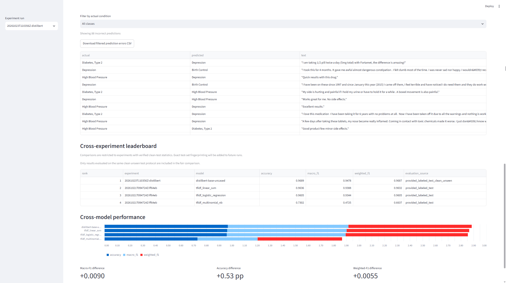
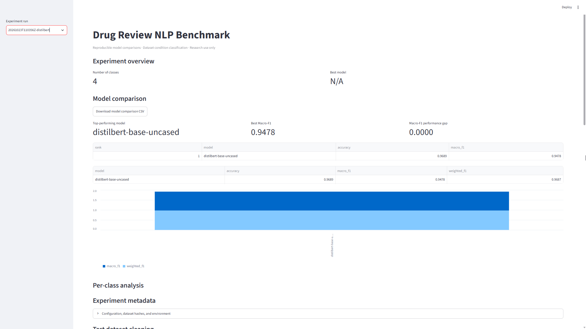
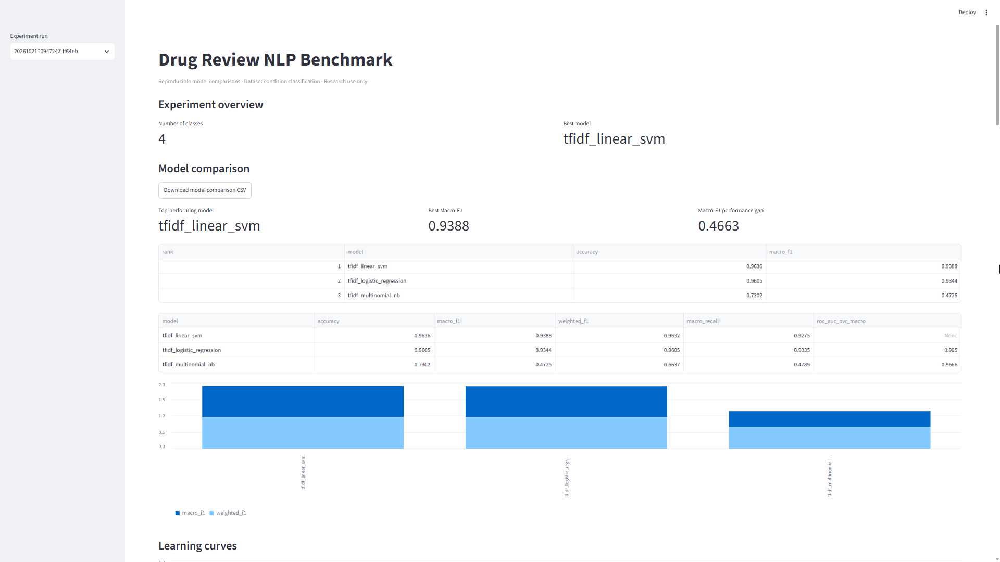
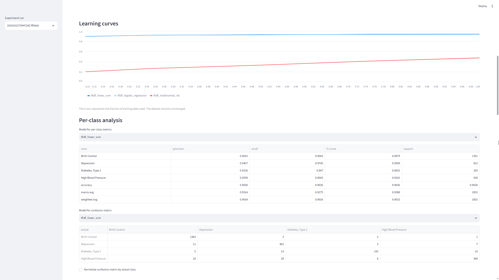
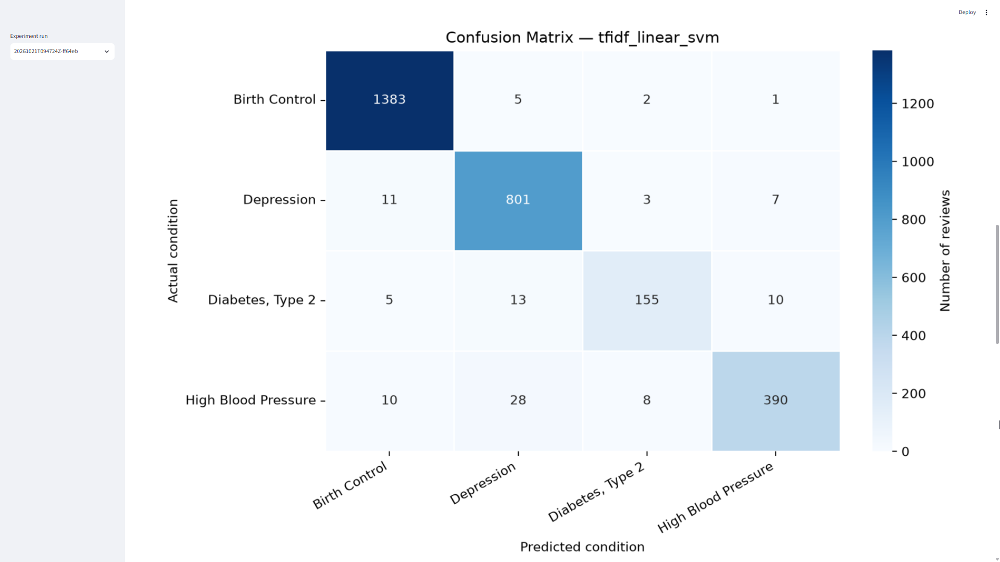
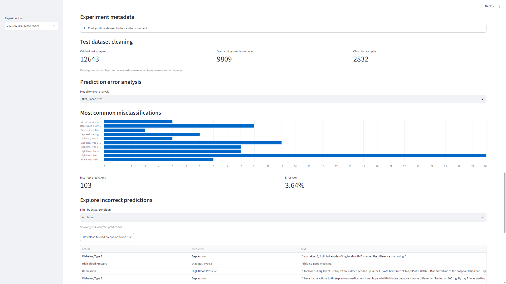

# Drug Review Benchmark

A reproducible NLP benchmark for predicting a drug review's **condition** label from its text. The project compares classical machine-learning models with a fine-tuned DistilBERT model using a leakage-resistant evaluation protocol.

**Disclaimer:** This is a machine-learning research and portfolio project. It is not a medical device. Predictions are not diagnoses or treatment recommendations.

## Benchmark Results

All reported models were evaluated on the same clean-test protocol, containing **2,832 reviews** after removing ambiguous and overlapping examples.

| Model | Accuracy | Macro-F1 | Weighted-F1 |
|---|---:|---:|---:|
| **DistilBERT** | **0.9689** | **0.9478** | **0.9687** |
| TF-IDF + Linear SVM | 0.9636 | 0.9388 | 0.9632 |
| TF-IDF + Logistic Regression | 0.9605 | 0.9344 | 0.9605 |
| TF-IDF + Multinomial Naive Bayes | 0.7302 | 0.4725 | 0.6637 |

DistilBERT achieved the highest macro-F1, outperforming the strongest classical baseline, Linear SVM, by approximately **0.90 percentage points**.

These results are specific to the selected dataset, four condition classes, and evaluation protocol. They do not establish clinical reliability or generalization to other medical datasets.

## Dashboard Screenshots

The Streamlit dashboard provides interactive visualizations of benchmark results, model performance, and prediction errors.

### Cross-Experiment Leaderboard



### DistilBERT Experiment Overview



### Classical ML Experiment Overview



### Learning Curves



### Confusion Matrix



### Prediction Error Analysis



## Task Definition

**Input:** Drug review text.

**Target:** One of four condition labels:

- Birth Control
- Depression
- Diabetes, Type 2
- High Blood Pressure

The task is supervised multiclass text classification, not disease diagnosis.

## Evaluation Protocol

The project uses the supplied labeled test split after cleaning to reduce train/test leakage.

| Cleaning step | Reviews |
|---|---:|
| Eligible test reviews before cleaning | 12,643 |
| Ambiguous test reviews removed | 2 |
| Train/test overlapping reviews removed | 9,809 |
| Final clean test reviews | **2,832** |

The clean test dataset is identified using a deterministic SHA-256 fingerprint:

`a52ea065995c4e050dc82f97343db055423ae346b1610065c69b260a92a96fa0`

The fingerprint is computed from review text and condition labels, including row order. The dashboard uses the fingerprint to filter benchmark runs for comparison.

For full details, see `docs/BENCHMARK_PROTOCOL.md`.

## Features

- Three TF-IDF classical ML baselines: Linear SVM, Logistic Regression, and Multinomial Naive Bayes.
- Fine-tuned `distilbert-base-uncased` Transformer classifier.
- Clean-test evaluation with overlap and ambiguity filtering.
- Accuracy, macro-F1, weighted-F1, and saved predictions.
- Classical ML learning curves, confusion matrices, and per-class metrics.
- Streamlit dashboard with experiment comparison, error analysis, and a cross-experiment leaderboard.
- SHA-256 dataset fingerprints and experiment metadata.
- FastAPI inference endpoint for a saved classical ML model.
- Automated tests.

## Installation

Python 3.12 was used for the completed Transformer experiment.

Create and activate a virtual environment:

```powershell
python -m venv .venv
.\.venv\Scripts\Activate.ps1
pip install -e ".[dev]"
```

For Transformer training, install the optional deep-learning dependencies:

```powershell
pip install -e ".[deep-learning]"
```

GPU training requires a compatible CUDA-enabled PyTorch installation. Consult the official PyTorch installation instructions for your GPU and CUDA environment.

## Dataset

Place the source TSV files at:

```text
data/raw/drugsComTrain_raw.tsv
data/raw/drugsComTest_raw.tsv
```

The expected columns are `review` and `condition`.

Dataset files are not included in this repository. Check the original dataset source, citation requirements, and license before downloading or redistributing the data.

## Run the Classical ML Benchmark

```powershell
drugbench run --config configs/default.yaml
```

Results are saved under:

```text
artifacts/runs/<run_id>/
```

Artifacts include model files, metrics, predictions, confusion matrices, learning-curve data, and run metadata.

## Train DistilBERT

```powershell
python -m src.deep_learning.train_transformer --config configs/default.yaml
```

The completed experiment used `distilbert-base-uncased`, two training epochs, and a clean test set of 2,832 reviews.

Transformer outputs are saved in a separate run directory containing the trained model, `metrics.json`, and prediction results.

The training process can take substantial time depending on GPU availability.

## Launch the Dashboard

```powershell
python -m streamlit run dashboard/app.py
```

The dashboard loads completed experiment artifacts and provides:

- Model performance comparisons.
- Cross-experiment leaderboard.
- Accuracy, macro-F1, and weighted-F1 charts.
- Classical ML learning curves and per-class analysis.
- Prediction error analysis.
- Clean-test fingerprint filtering for comparable runs.

Both classical ML and DistilBERT results are supported.

## Run the Prediction API

After training and saving a supported classical ML model:

```powershell
python -m uvicorn api.main:app --reload
```

Open `http://127.0.0.1:8000/docs` to inspect the API.

Example request:

```json
{
  "text": "This medication helped with my symptoms and I experienced mild nausea."
}
```

The returned class is a dataset prediction, not a clinical assessment.

## Run Tests

```powershell
python -m pytest -q
```

The current test suite contains **15 passing tests**, including checks for result loading, clean-test comparability, and deterministic fingerprints.

## Repository Structure

```text
api/                     FastAPI prediction endpoint
configs/                 Experiment configuration
dashboard/               Streamlit dashboard
docs/                    Benchmark protocol documentation
src/data.py              Dataset preparation and cleaning
src/dashboard_results.py Result parsing and fingerprint utilities
src/experiment.py        Classical ML experiment runner
src/models.py            Classical ML pipelines
src/metrics.py           Evaluation utilities
src/deep_learning/       DistilBERT training
tests/                   Automated tests
artifacts/               Generated experiment outputs
data/                    Local dataset files
```

## Reproducibility and Limitations

- The benchmark uses a fixed set of four condition labels.
- Test examples overlapping with the training data are excluded.
- Clean-test fingerprints support comparison across saved experiments.
- Model selection should use training/validation data rather than repeated test-set evaluation.
- Performance may change with different datasets, class distributions, preprocessing, and random seeds.
- The models should not be used for clinical decisions.

## License and Data Attribution

Before publishing this repository, add the original dataset citation and confirm its license and usage terms. Model weights and generated artifacts should be distributed only when their respective licenses and storage requirements permit.